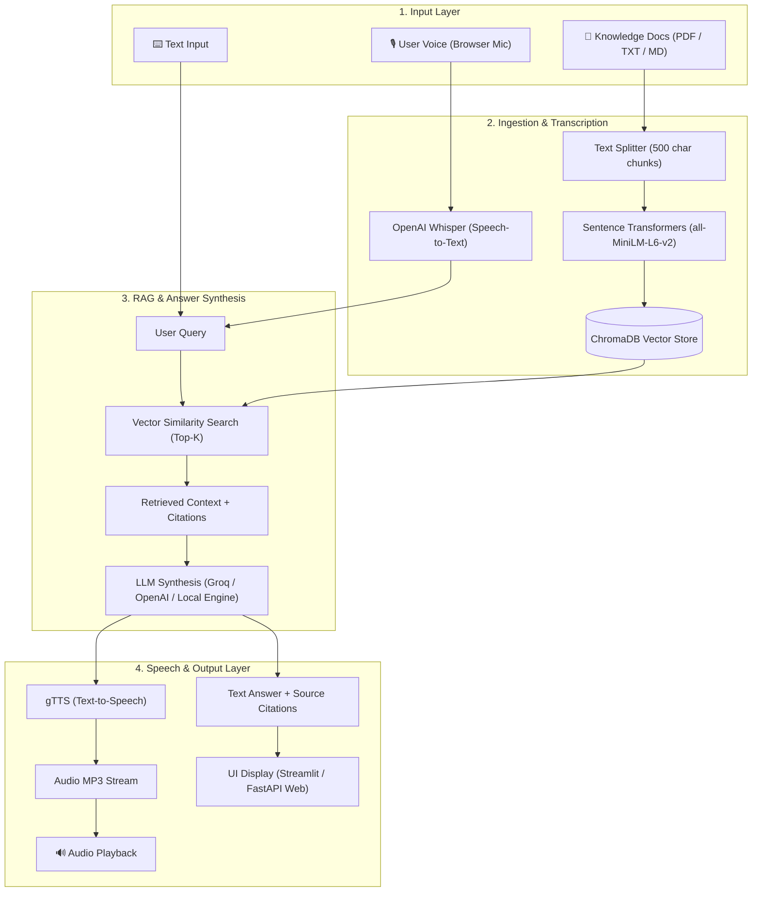

<div align="center">

# 🎙️ Voice RAG Assistant
### *Multilingual Audio-Enabled Knowledge Retrieval & Conversational Agent*

[](https://www.python.org/)
[](https://fastapi.tiangolo.com/)
[](https://streamlit.io/)
[](https://github.com/openai/whisper)
[](https://www.trychroma.com/)
[](LICENSE)

<p align="center">
  <b>Talk directly to your documents with your microphone, and hear accurate, cited answers spoken back in natural voice.</b><br>
  Powered by OpenAI Whisper (Speech-to-Text), ChromaDB & Sentence Transformers (RAG), and Google TTS (Text-to-Speech).
</p>

[Key Features](#-key-features) •
[Architecture](#-system-architecture) •
[Quick Start](#-quick-start) •
[Project Structure](#-project-structure) •
[API Reference](#-api-reference) •
[Configuration](#-configuration)

---

</div>

## 🌟 Overview

**Voice RAG Assistant** is an end-to-end conversational AI platform that bridges voice interaction with Retrieval-Augmented Generation (RAG). 

Instead of reading lengthy documents or typing long prompts, users can simply press record, speak their questions in **Hindi, Hinglish, or English**, and receive concise, contextually accurate answers spoken aloud by the assistant, backed by real-time document citations (document name, page number, and similarity score).

The system includes **two ready-to-use interfaces**:
1. 🎈 **Streamlit Interactive Frontend**: Featuring browser-based microphone recording, file drag-and-drop, real-time audio playback, and document management.
2. ⚡ **FastAPI High-Performance Web Dashboard**: A sleek, dark glassmorphism web UI with real-time audio visualizers, full REST API endpoints, and static file serving.

---

## 🚀 Key Features

- **🎙️ Speech-to-Text (STT)**: Offline-capable speech recognition powered by OpenAI Whisper (`tiny`, `base`, `small`, etc.) with automatic FFmpeg configuration for Windows and Linux.
- **📚 Dynamic Document Ingestion**: Upload and index `.pdf`, `.txt`, and `.md` files on the fly. Chunks are automatically split with overlap using `RecursiveCharacterTextSplitter`.
- **🧠 Vector Search & Knowledge Retrieval**: Fast semantic search using `all-MiniLM-L6-v2` embeddings and persistent local storage via `ChromaDB`.
- **🔊 Natural Text-to-Speech (TTS)**: Realistic speech synthesis via `gTTS` with support for Hindi (`hi`) and English (`en`), complete with automated temporary file lifecycle management.
- **📑 Document Citations & Transparency**: Every answer includes the source document, page number, and vector similarity distance for complete auditability.
- **🤖 Flexible LLM Engine**: Native support for **Groq (Llama 3)**, **OpenAI (GPT-4o mini)**, with an intelligent built-in extractive synthesis engine that works **100% locally without external paid API keys**.
- **🛡️ Windows Ready**: Bundled with pre-configured `.bat` and `.ps1` one-click launchers, local `.streamlit` permission isolation, and automated FFmpeg binary detection.

---

## 🏗️ System Architecture



---

## 📁 Project Structure

```plaintext
d:\voice
├── backend
│   ├── app
│   │   ├── config.py              # Centralized Pydantic settings & path resolution
│   │   ├── main.py                # FastAPI REST API & Static UI endpoints
│   │   ├── services
│   │   │   ├── stt_services.py    # OpenAI Whisper STT wrapper & FFmpeg resolver
│   │   │   ├── tts_services.py    # gTTS audio generation & cleanup service
│   │   │   └── rag_services.py    # ChromaDB vector store & retrieval pipeline
│   │   └── static
│   │       └── index.html         # FastAPI Glassmorphism Web Dashboard
│   ├── requirements.txt           # Project dependencies
│   ├── .env                       # Active environment configuration
│   └── .env.example               # Environment variables template
├── data
│   ├── documents                  # Uploaded PDF and text documents
│   ├── vector_db                  # ChromaDB persistent database files
│   └── temp_audio                 # Generated TTS MP3 files
├── .streamlit
│   ├── config.toml                # Streamlit UI & server configuration
│   └── credentials.toml           # Streamlit local credentials bypass
├── streamlit_app.py               # Streamlit interactive frontend
├── run_streamlit.py               # Streamlit Python runner
├── run_streamlit.bat              # One-click Windows batch launcher
├── run_streamlit.ps1              # One-click PowerShell launcher
├── run.py                         # FastAPI Uvicorn server launcher
├── .gitignore                     # Git ignore rules for virtualenv, DB & audio
└── README.md
```

---

## ⚡ Quick Start

### 1. Prerequisites
- **Python 3.10+** installed
- Git installed
- Microphone & speakers enabled

### 2. Clone the Repository
```bash
git clone https://github.com/your-username/voice-rag-assistant.git
cd voice-rag-assistant
```

### 3. Create & Activate Virtual Environment
**On Windows (PowerShell):**
```powershell
python -m venv backend\venv
.\backend\venv\Scripts\activate
```

**On Linux / macOS:**
```bash
python3 -m venv backend/venv
source backend/venv/bin/activate
```

### 4. Install Dependencies
```bash
pip install -r backend/requirements.txt
```

### 5. Configure Environment Variables
Copy `.env.example` to `backend/.env`:
```bash
cp .env.example backend/.env
```
*(Optional)* Add your **Groq API Key** (`GROQ_API_KEY`) or **OpenAI API Key** (`OPENAI_API_KEY`) in `backend/.env` for enhanced natural language answers. If left blank, the assistant automatically uses its built-in local extraction engine!

---

## 🚀 Running the Application

### Option A: Streamlit Interactive Frontend 🎈 (Recommended)
You can launch Streamlit using any of the following convenient options:

- **Windows Batch File**: Double-click `run_streamlit.bat`
- **PowerShell**:
  ```powershell
  .\run_streamlit.ps1
  ```
- **Direct Python**:
  ```bash
  python run_streamlit.py
  ```

Open your browser at: **[http://127.0.0.1:8501](http://127.0.0.1:8501)**

---

### Option B: FastAPI Web Dashboard & REST Server ⚡
Run the FastAPI production-ready server:
```bash
python run.py
```

Open your browser at:
- **Web Dashboard**: **[http://127.0.0.1:8000](http://127.0.0.1:8000)**
- **Interactive Swagger API Docs**: **[http://127.0.0.1:8000/docs](http://127.0.0.1:8000/docs)**

---

## 🌐 API Reference

| Method | Endpoint | Description | Request Body / Params |
| :--- | :--- | :--- | :--- |
| `GET` | `/` | Serves the interactive Web Dashboard | None |
| `GET` | `/api/status` | Health check & vector DB statistics | None |
| `POST` | `/api/chat/voice` | Transcribes audio, queries RAG, returns audio | `multipart/form-data` (`audio`: file, `lang`: `hi`/`en`) |
| `POST` | `/api/chat/text` | Queries RAG via text, returns text & audio | `{"query": "string", "lang": "hi"}` |
| `POST` | `/api/documents/upload` | Uploads and indexes PDF/TXT document | `multipart/form-data` (`file`: file) |
| `GET` | `/api/documents` | Lists all indexed documents | None |
| `DELETE` | `/api/documents/{filename}` | Deletes a document and rebuilds index | `filename` in path |
| `POST` | `/api/documents/reindex` | Triggers a full re-index of the knowledge base | None |
| `GET` | `/api/audio/{filename}` | Streams generated TTS MP3 audio | `filename` in path |

### Example Voice Query via cURL
```bash
curl -X POST "http://127.0.0.1:8000/api/chat/voice" \
  -F "audio=@my_question.wav" \
  -F "lang=hi"
```

### Example Text Query via cURL
```bash
curl -X POST "http://127.0.0.1:8000/api/chat/text" \
  -H "Content-Type: application/json" \
  -d '{"query": "What is Audio RAG Assistant?", "lang": "en"}'
```

---

## ⚙️ Configuration

Key settings can be modified in `backend/.env`:

| Variable | Default | Description |
| :--- | :--- | :--- |
| `WHISPER_MODEL_SIZE` | `base` | Whisper model size (`tiny`, `base`, `small`, `medium`) |
| `GROQ_API_KEY` | `""` | Optional Groq API key for ultra-fast Llama 3 answers |
| `OPENAI_API_KEY` | `""` | Optional OpenAI API key for GPT-4o mini synthesis |
| `DEFAULT_LANGUAGE` | `hi` | Primary language for TTS (`hi` for Hindi, `en` for English) |
| `DOCUMENTS_DIR` | `./data/documents` | Folder for storing knowledge base source files |
| `VECTOR_DB_DIR` | `./data/vector_db` | Storage path for ChromaDB vector embeddings |
| `TEMP_AUDIO_DIR` | `./data/temp_audio` | Path for cached response audio files |

---

## 🛠️ Tech Stack

- **Audio Recognition**: [OpenAI Whisper](https://github.com/openai/whisper)
- **Speech Synthesis**: [gTTS (Google Text-to-Speech)](https://github.com/pndurette/gTTS)
- **Audio Processing**: [imageio-ffmpeg](https://github.com/imageio/imageio-ffmpeg)
- **Vector Database**: [ChromaDB](https://www.trychroma.com/)
- **Embeddings**: [Hugging Face Sentence Transformers](https://sbert.net/) (`all-MiniLM-L6-v2`)
- **Document Loading & Chunking**: [LangChain](https://www.langchain.com/) (`PyPDFLoader`, `RecursiveCharacterTextSplitter`)
- **Backend Framework**: [FastAPI](https://fastapi.tiangolo.com/) & [Uvicorn](https://www.uvicorn.org/)
- **Frontend Framework**: [Streamlit](https://streamlit.io/) & [audio-recorder-streamlit](https://github.com/jrieke/audio-recorder-streamlit)

---

## 🤝 Contributing

Contributions, issues, and feature requests are welcome!
1. Fork the Project
2. Create your Feature Branch (`git checkout -b feature/AmazingFeature`)
3. Commit your Changes (`git commit -m 'Add some AmazingFeature'`)
4. Push to the Branch (`git push origin feature/AmazingFeature`)
5. Open a Pull Request

---

## 📄 License

Distributed under the **MIT License**. See `LICENSE` for more information.
